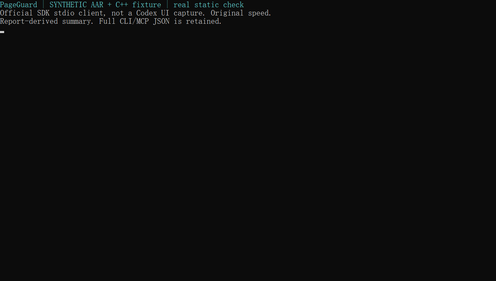
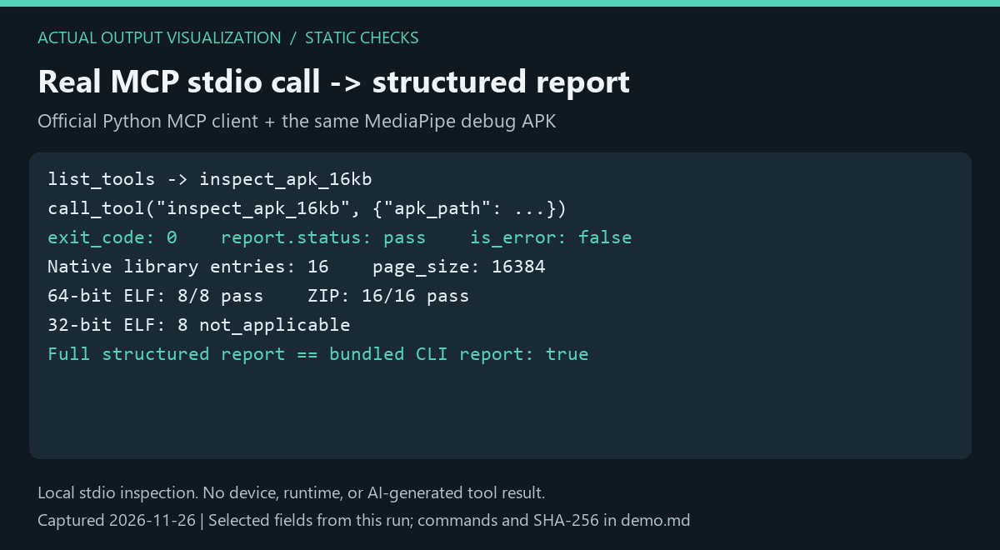

# Android MCP Inspector

[](https://github.com/LeeJUNhao791/android-mcp-inspector/actions/workflows/ci.yml)
[](https://github.com/LeeJUNhao791/android-mcp-inspector/releases/latest)
[](LICENSE)

[简体中文](README.zh-CN.md)

A local MCP server that checks Android projects and APKs for 16 KB alignment and traces native libraries to candidate AARs. The stdio tool `inspect_apk_16kb` checks the ELF segments and ZIP layout of an APK you own or are authorized to inspect.

## PageGuard: 15-second project demo



The CLI and official Python MCP SDK over stdio return the same complete report: the synthetic ELF has `p_align=4096`, and an explicit C++ page-size definition produces an advisory. This is an actual tool recording, not a Codex UI recording or an installable app test.

**Start here:** [Windows paired source-ZIP quickstart](docs/portable-preview.md). Clean extraction with cached dependency installation was accepted on Windows. Linux fresh installation was not independently accepted. Static AAR/source checks do not prove final APK ZIP alignment, installation, JNI or 16 KB device behavior; no patches are applied. [Recording provenance and SHA-256](docs/assets/media-manifest.json).



Actual output visualization from an official Python MCP client calling the local server on 2026-11-26. The real MediaPipe debug APK passed static alignment checks; device behavior requires separate testing. [Reproduce the call and check the input hash](docs/assets/demo.md).

## Set up

For a paired source ZIP with the compatible Toolkit, exact MCP dependency pins
and setup without an Android SDK, see the [PageGuard portable source preview](docs/portable-preview.md).
This local preview is separate from published releases.

Use Python 3.11 or newer. Run these commands from the repository root with a virtual environment outside the checkout.

Windows (PowerShell)

```powershell
$inspectorEnv = Join-Path $env:TEMP 'android-mcp-inspector-venv'
python -m venv $inspectorEnv
$inspectorPython = Join-Path $inspectorEnv 'Scripts/python.exe'
& $inspectorPython -m pip install -r requirements.txt
# Project-tool tests also need the pinned Toolkit checkout described below.
$env:ANDROID_SDK_TOOLKIT_ROOT = 'C:/path/to/android-sdk-toolkit'
& $inspectorPython -B -m unittest discover -s tests -v
```

Ubuntu

```bash
python3 -m venv ~/.venvs/android-mcp-inspector
~/.venvs/android-mcp-inspector/bin/python -m pip install -r requirements.txt
# Project-tool tests also need the pinned Toolkit checkout described below.
export ANDROID_SDK_TOOLKIT_ROOT=/path/to/android-sdk-toolkit
~/.venvs/android-mcp-inspector/bin/python -B -m unittest discover -s tests -v
```

The smoke tests launch the server using the [official Python MCP client over stdio](https://py.sdk.modelcontextprotocol.io/client/transports/#stdio) and compare complete responses with direct CLI runs on synthetic fixtures.

## Connect a client

Configure a local stdio server with the virtual environment's Python executable as its command and `server.py` as its only argument.

### VS Code editor-managed MCP

Open the repository folder in VS Code and add `.vscode/mcp.json` with the following content. Replace `command` with the full path to your virtual environment's Python executable.

```json
{
  "servers": {
    "android-mcp-inspector": {
      "type": "stdio",
      "command": "C:/path/to/android-mcp-inspector-venv/Scripts/python.exe",
      "args": ["${workspaceFolder}/server.py"]
    }
  }
}
```

Start `android-mcp-inspector` from **MCP: List Servers** in the Command Palette. See Microsoft's [MCP configuration reference](https://code.visualstudio.com/docs/agents/reference/mcp-configuration#editor-managed-configuration-for-local-harness-compatibility) for editor-managed setup and Copilot forwarding.

### Clients that use `mcpServers`

Use absolute paths for both the Python executable and `server.py`.

```json
{
  "mcpServers": {
    "android-mcp-inspector": {
      "command": "C:/path/to/android-mcp-inspector-venv/Scripts/python.exe",
      "args": ["C:/path/to/android-mcp-inspector/server.py"]
    }
  }
}
```

## Try the synthetic example

The `v0.1.1` and later source archives include this example.

From the repository root, generate the archives in a new directory using Python 3.11 or newer. The generator runs offline with the standard library and the bundled test fixture.

```powershell
python -B examples/make_trial.py 'C:/Temp/Android MCP Trial'
```

The example creates `trial.apk`, `device.aar`, `decoy.aar`, and `aar-manifest.json`. Both AARs contain `jni/arm64-v8a/libdevice.so`. Only `device.aar` contains the same bytes as the APK entry. The synthetic archives are for inspection only.

Call `inspect_apk_16kb` with this input, replacing the directory in both paths if you used a different location.

```json
{
  "apk_path": "C:/Temp/Android MCP Trial/trial.apk",
  "aar_manifest": "C:/Temp/Android MCP Trial/aar-manifest.json"
}
```

The response includes these values.

| Field | Expected value |
| --- | --- |
| `exit_code`, `report.status`, `report.page_size` | `1`, `fail`, `16384` |
| `entry`, `elf`, `zip`, `zip_data_offset` in `report.libraries[0]` | `lib/arm64-v8a/libdevice.so`, `fail`, `pass`, `16384` |
| `load_issues[0].p_align` | `4096` |
| `origin.status`, `origin.candidates[0].coordinate` | `single_candidate`, `example:device-native:1` |
| `origin.sha256` | `7240b15ae351fa6c080791c11a763db475d3286c134d956ac6b8cf38adac5b88` |

## Verify a real MediaPipe APK

Build Google's Image Classification sample and check its debug APK with the released Inspector CLI and MCP server. Follow the [MediaPipe verification guide](examples/mediapipe.md).

## Call the tool

Pass the APK's absolute path on the machine that runs the server. Supply the two optional inputs from the same build as the APK. If you provide `native_provenance`, also provide `aar_manifest`.

```json
{
  "apk_path": "C:/Android builds/app-debug.apk",
  "aar_manifest": "C:/Android builds/resolved aars.json",
  "native_provenance": "C:/Android builds/native provenance.json"
}
```

The structured response contains `exit_code` and `report`. The checker supplies the exit code and the full JSON report. All four checker outcomes are returned as tool results.

| Exit code | Report status | Meaning |
| --- | --- | --- |
| 0 | `pass` | Checked libraries pass the applicable alignment checks. |
| 1 | `fail` | At least one checked library fails ELF or ZIP alignment. |
| 2 | `invalid` | The checker rejected the APK or an accompanying input. |
| 3 | `not_applicable` | No arm64-v8a or x86_64 shared libraries were found, and all applicable ZIP alignment checks passed. |

When attribution is available, the report preserves `single_candidate`, `multiple_candidates`, or `unknown` and identifies the evidence method when the checker reports one.

## Inspect local Android/UTS projects (source prototype)

`inspect_android_project_16kb` delegates to an **external, trusted Toolkit checkout**.
The baseline AAR scanner shipped in Toolkit v0.12.0; its published archive does
not contain the new `--source-file` advisory flag. Use [Toolkit commit `8bde890`](https://github.com/LeeJUNhao791/android-sdk-toolkit/commit/8bde8902cbcb38454bcc77529aec40d5bfbd3347)
for the tested source advisory contract. This revision is a source prototype,
not a released registry package. Keep its sibling Skills present. Configure the
server process with the absolute checkout root, for example in your client's
server entry (alongside `command` and `args`):

```json
"env": { "ANDROID_SDK_TOOLKIT_ROOT": "C:/path/to/android-sdk-toolkit" }
```

The checkout must already exist; the server never clones, installs or downloads
it. Only APK inspection works without it. Missing setup, incompatible reports,
argument/preflight failures without JSON and scanner timeouts are tool errors,
not passing project reports. The project subprocess has a 120-second timeout.
The existing APK tool and bundled checker are unchanged.

Call `inspect_android_project_16kb` with:

```json
{
  "project_root": "C:/Android projects/example",
  "expected_abis": ["arm64-v8a"],
  "source_files": ["app/src/main/cpp/pages.cpp"]
}
```

Only `project_root` is required. AAR scope is direct
`app/libs/*.aar` and `uni_modules/*/utssdk/app-android/libs/*.aar`.
`expected_abis` optionally requires each ABI in **every** AAR, including Java-only
AARs. The response preserves the complete CLI `report` and `exit_code`:
`pass`=0, `fail`=1, `invalid`=2, `no_matches`=3. Invalid input takes precedence;
valid sibling results and relative paths/AAR/SO SHA-256 remain available.
`no_matches` is not pass; a Java-only/32-bit AAR with `elf64_count: 0` has no
64-bit ELF alignment proof. AAR ZIP layout does not prove APK ZIP alignment.

Optional `source_files` explicitly selects project-relative UTF-8 C/C++ files
with POSIX `/` separators; no recursive source search. At most 100 requests,
1 MiB per file and 2000 hints are allowed. Traversal, external paths and
symlinks/reparse points below the root are invalid. The separate `source_advisories`
contains file hashes and line/rule hints for explicit 4096 page-size definitions
and contextual page-alignment literals. Ordinary 4096 buffers, comments and
quoted strings are ignored. Hints never change AAR pass/fail/no_matches; invalid
source input returns invalid while preserving AAR results. Without source files,
the original Toolkit project schema is unchanged.

These narrow lexical heuristics are advisory, not proof of a defect, safe source
or 16 KB runtime behavior. They can miss or misread aliases, multiline expressions,
raw strings and program semantics. No patches are generated or applied; closed
AARs require supplier remediation based on the reported hashes. The MCP tool
performs no builds, downloads, input edits or output-file writes. Final APK
packaging and device/JNI execution need separate checks.

To reproduce the direct CLI report:

```sh
python -I -B /path/to/android-sdk-toolkit/skills/android-project-check/scripts/check_project.py --expect-abi=arm64-v8a --source-file=app/src/main/cpp/pages.cpp -- /path/to/project
```

The official stdio tests compare complete project CLI reports for pass, fail,
no_matches, invalid, no ELF, advisory hints and setup failures, with input hashes
and read-only snapshots. Fixtures in these tests are synthetic, not installable
Android builds. CI checks out the exact Toolkit revision above.

## Feedback

Share first-use feedback on the synthetic trial in [issue #3](https://github.com/LeeJUNhao791/android-mcp-inspector/issues/3). For a reproducible defect, use the [bug report template](https://github.com/LeeJUNhao791/android-mcp-inspector/issues/new?template=bug_report.md). Remove private paths and use synthetic or redistributable inputs.

## Upstream code

The bundled checker and its CLI tests come from [Android SDK Toolkit v0.8.0](https://github.com/LeeJUNhao791/android-sdk-toolkit/tree/dbd640e7b4ccd8a87beb8ca1ed21be3b301b979c/skills/apk-page-size-check). The included [MIT license](LICENSE) covers these files. To run the upstream CLI suite, use `python -B -m unittest discover -s vendor/apk-page-size-check/tests -v`.

## Contributing

See the [contribution guide](CONTRIBUTING.md) for bug report details, development checks and pull request guidance.
