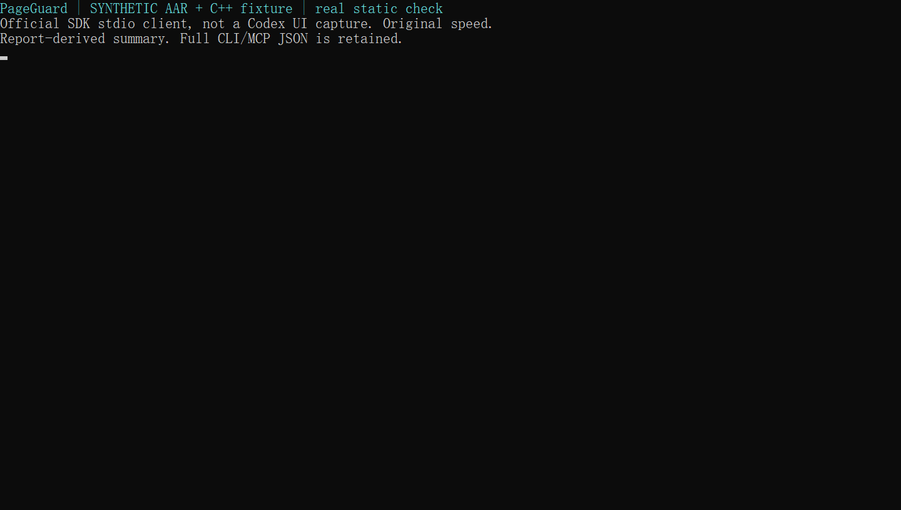
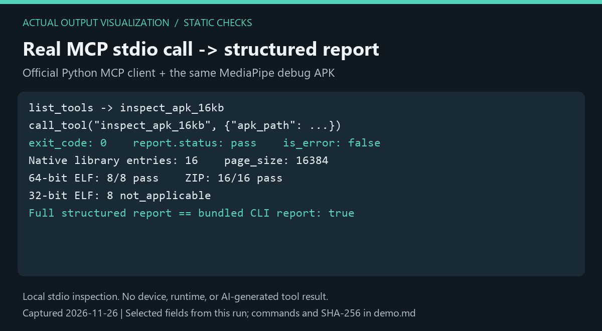

# Android MCP Inspector

配套 Toolkit 的源码 ZIP、固定 MCP 依赖和无需 Android SDK 的准备方法见
[PageGuard 便携源码预览包](docs/portable-preview.zh-CN.md)。该本地预览与正式发布分开。

[](https://github.com/LeeJUNhao791/android-mcp-inspector/actions/workflows/ci.yml)
[](https://github.com/LeeJUNhao791/android-mcp-inspector/releases/latest)
[](LICENSE)

[English](README.md)

本地 MCP 服务，通过 stdio 提供 `inspect_apk_16kb` 工具，检查 APK 的 ELF 段与 ZIP 布局是否满足 Android 16 KB 对齐要求。可结合同一次构建的 AAR 清单和原生库溯源数据，查找候选依赖。

工具读取你拥有或获准检查的本地文件，不修改 APK 或修复 ELF。静态检查结果不等于真机安装、启动或运行验证。

## PageGuard：15 秒项目检查演示



CLI 和通过 stdio 调用的官方 Python MCP SDK 返回相同的完整报告：合成 ELF 的 `p_align=4096`，明确的 C++ 页大小定义产生一条建议。这是实际工具录屏，不是 Codex 界面录屏，也不是可安装应用的测试。

**从这里开始：**[Windows 双仓库源码 ZIP 上手](docs/portable-preview.zh-CN.md)。已在 Windows 完成干净解压及缓存依赖安装验收；Linux 全新安装尚未独立验收。静态 AAR/源码检查不证明最终 APK ZIP 对齐、安装、JNI 或 16 KB 设备行为，也不应用补丁。[录屏来源与 SHA-256](docs/assets/media-manifest.json)。



2026-11-26 用官方 Python MCP 客户端实际调用本地服务，将输出制作成静态可视化。真实 MediaPipe 调试 APK 的静态对齐检查通过，设备运行需单独验证。[复现调用与输入哈希](docs/assets/demo.md)。

## 安装与自检

使用 Python 3.11 或更新版本。在仓库根目录执行，把虚拟环境放在仓库外。

Windows PowerShell：

```powershell
$inspectorEnv = Join-Path $env:TEMP 'android-mcp-inspector-venv'
python -m venv $inspectorEnv
$inspectorPython = Join-Path $inspectorEnv 'Scripts/python.exe'
& $inspectorPython -m pip install -r requirements.txt
& $inspectorPython -B -m unittest discover -s tests -v
```

Ubuntu：

```bash
python3 -m venv ~/.venvs/android-mcp-inspector
~/.venvs/android-mcp-inspector/bin/python -m pip install -r requirements.txt
~/.venvs/android-mcp-inspector/bin/python -B -m unittest discover -s tests -v
```

依赖固定在 [requirements.txt](requirements.txt)。测试使用官方 Python MCP 客户端，通过真实 stdio 启动服务，并与检查器直接运行的完整输出比较；输入使用合成样例。

## 接入 MCP 客户端

将虚拟环境中的 Python 可执行文件设为启动命令，`server.py` 设为唯一参数。

### VS Code 编辑器管理的 MCP

在 VS Code 打开仓库目录，创建 `.vscode/mcp.json`。把 `command` 替换为虚拟环境 Python 的绝对路径。

```json
{
  "servers": {
    "android-mcp-inspector": {
      "type": "stdio",
      "command": "C:/path/to/android-mcp-inspector-venv/Scripts/python.exe",
      "args": ["${workspaceFolder}/server.py"]
    }
  }
}
```

在命令面板运行 **MCP: List Servers**，启动 `android-mcp-inspector`。编辑器配置与 Copilot 转发方式见 [Microsoft 配置参考](https://code.visualstudio.com/docs/agents/reference/mcp-configuration#editor-managed-configuration-for-local-harness-compatibility)。

### 使用 `mcpServers` 的客户端

Python 和 `server.py` 均填写绝对路径。

```json
{
  "mcpServers": {
    "android-mcp-inspector": {
      "command": "C:/path/to/android-mcp-inspector-venv/Scripts/python.exe",
      "args": ["C:/path/to/android-mcp-inspector/server.py"]
    }
  }
}
```

## 试用合成 APK

从 `v0.1.1` 起，发布的源码包包含此示例。从源码根目录生成样例，输出目录必须尚不存在：

```powershell
python -B examples/make_trial.py 'C:/Temp/Android MCP Trial'
```

生成器仅使用 Python 标准库和仓库内测试夹具，可离线运行。生成 `trial.apk`、`device.aar`、`decoy.aar` 和 `aar-manifest.json`。这些合成归档仅供检查，不用于安装运行。

在客户端调用 `inspect_apk_16kb`，传入以下参数；若修改了生成目录，同时修改两个路径：

```json
{
  "apk_path": "C:/Temp/Android MCP Trial/trial.apk",
  "aar_manifest": "C:/Temp/Android MCP Trial/aar-manifest.json"
}
```

这个样例故意不满足 ELF 对齐要求，成功复现时应返回失败报告：

| 字段 | 预期值 |
| --- | --- |
| `exit_code`、`report.status`、`report.page_size` | `1`、`fail`、`16384` |
| `report.libraries[0].entry` | `lib/arm64-v8a/libdevice.so` |
| 同一库的 `elf`、`zip`、`zip_data_offset` | `fail`、`pass`、`16384` |
| `load_issues[0].p_align` | `4096` |
| `origin.status`、`origin.candidates[0].coordinate` | `single_candidate`、`example:device-native:1` |
| `origin.sha256` | `7240b15ae351fa6c080791c11a763db475d3286c134d956ac6b8cf38adac5b88` |

两个 AAR 都含有 `jni/arm64-v8a/libdevice.so`，只有 `device.aar` 的库字节与 APK 中相同。

## 验证真实 MediaPipe APK

构建 Google 的 Image Classification 示例，用 Inspector 正式版的 CLI 和 MCP 服务检查 debug APK。见 [MediaPipe 验证指南](examples/mediapipe.zh-CN.md)。

## 检查自己的 APK

路径指向运行服务的机器。可选的 `aar_manifest` 和 `native_provenance` 必须来自 APK 的同一次构建；提供 `native_provenance` 时必须同时提供 `aar_manifest`。

```json
{
  "apk_path": "C:/Android builds/app-debug.apk",
  "aar_manifest": "C:/Android builds/resolved aars.json",
  "native_provenance": "C:/Android builds/native provenance.json"
}
```

结构化响应包含 `exit_code` 和完整的 `report`。以下四种检查结果都会作为工具结果返回；其中 `fail` 表示检查完成后发现不对齐。

| 退出码 | 报告状态 | 含义 |
| --- | --- | --- |
| `0` | `pass` | 已检查的库满足适用的对齐检查。 |
| `1` | `fail` | 至少一个已检查库未通过 ELF 或 ZIP 对齐检查。 |
| `2` | `invalid` | APK 或附带输入被检查器拒绝。 |
| `3` | `not_applicable` | 没有 arm64-v8a 或 x86_64 共享库，且所有适用的 ZIP 对齐检查通过。 |

溯源结果保留 `single_candidate`、`multiple_candidates` 或 `unknown`。候选 AAR 及证据方法以报告为准；同名库不代表已经确认来源。

## 反馈与上游

首次使用合成样例的体验请回复 [Issue #3](https://github.com/LeeJUNhao791/android-mcp-inspector/issues/3)。可复现的缺陷请使用 [Bug 模板](https://github.com/LeeJUNhao791/android-mcp-inspector/issues/new?template=bug_report.md)，删除私有路径并使用可公开的样例。

内置检查器和 CLI 测试来自 [Android SDK Toolkit v0.8.0](https://github.com/LeeJUNhao791/android-sdk-toolkit/tree/dbd640e7b4ccd8a87beb8ca1ed21be3b301b979c/skills/apk-page-size-check)，适用本仓库的 [MIT 许可证](LICENSE)。可独立运行内置 CLI 测试：

```sh
python -B -m unittest discover -s vendor/apk-page-size-check/tests -v
```

## 参与贡献

提交问题或改动前，请阅读[贡献指南](CONTRIBUTING.md)中的复现信息、开发检查与拉取请求说明。

## Android/UTS 本地项目检查（源码原型）

新增 `inspect_android_project_16kb`，复用外部可信 Toolkit 检出目录，不复制整套工具。
基础 AAR 巡检已在 v0.12.0 发布，但该归档不包含新增 `--source-file` 提示参数。
已验证的源码版本为 [Toolkit `8bde890`](https://github.com/LeeJUNhao791/android-sdk-toolkit/commit/8bde8902cbcb38454bcc77529aec40d5bfbd3347)，
尚未作为本功能发版。请保持兄弟 Skill 完整，在 MCP 服务配置中添加：

```json
"env": { "ANDROID_SDK_TOOLKIT_ROOT": "C:/path/to/android-sdk-toolkit" }
```

目录必须事先存在，服务不会自动下载或安装。未配置时 APK 工具仍可用；项目工具返回
明确的工具错误。配置错误、不兼容报告、参数/预检没有 JSON 或 120 秒超时均不是通过。
本地测试也需设置该环境变量；CI 固定使用上述提交。完整操作见英文 README 对应章节。

```json
{
  "project_root": "C:/Android projects/example",
  "expected_abis": ["arm64-v8a"],
  "source_files": ["app/src/main/cpp/pages.cpp"]
}
```

仅 `project_root` 必填。AAR 范围为 `app/libs/*.aar` 及
`uni_modules/*/utssdk/app-android/libs/*.aar` 的直接文件。可选 ABI 要求适用于每个 AAR，
包括纯 Java AAR。完整 `report` 和 `exit_code` 保持 CLI 的四种结果：通过 0、失败 1、
无效输入 2、无匹配 3；无效优先，保留其他 AAR 结果、相对路径与 AAR/SO 摘要。
无匹配不代表通过；`elf64_count: 0` 不代表完成 64 位对齐验证。AAR 不证明 APK ZIP 对齐。

`source_files` 只读检查明确指定的项目内 UTF-8 C/C++ 文件，统一使用 `/` 分隔符，
不递归搜索。最多 100 个请求、每文件 1 MiB、总计 2000 条提示；越界路径、父目录穿越及
项目根目录以下的符号链接/重解析点无效。`source_advisories` 提供源码摘要、行号和规则，
针对明确的 4096 页大小定义及有上下文的页地址对齐表达式；普通缓冲区、注释、字符串内
的 4096 不会一律报警。提示不改变 AAR 通过、失败或无匹配结果；源码输入无效则整体无效，
并保留 AAR 结果。省略源码文件时，原有项目 JSON 格式保持不变。

这些词法提示需人工复核，不证明缺陷、源码安全或 16 KB 运行兼容性。别名、多行表达式、
原始字符串和程序语义可能漏报或误判。不生成或应用补丁，不修复闭源 AAR；应基于摘要
要求供应商整改。工具不构建、不下载、不修改输入、不写输出文件；最终 APK 打包及设备/JNI
运行另行验证。官方 stdio 测试使用明确标注的合成夹具，并对比完整 CLI 报告与输入摘要。
